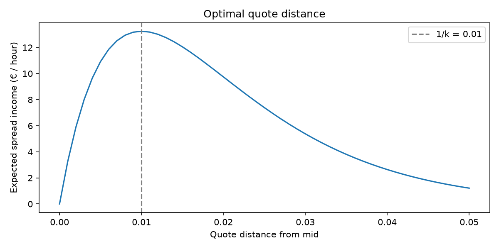
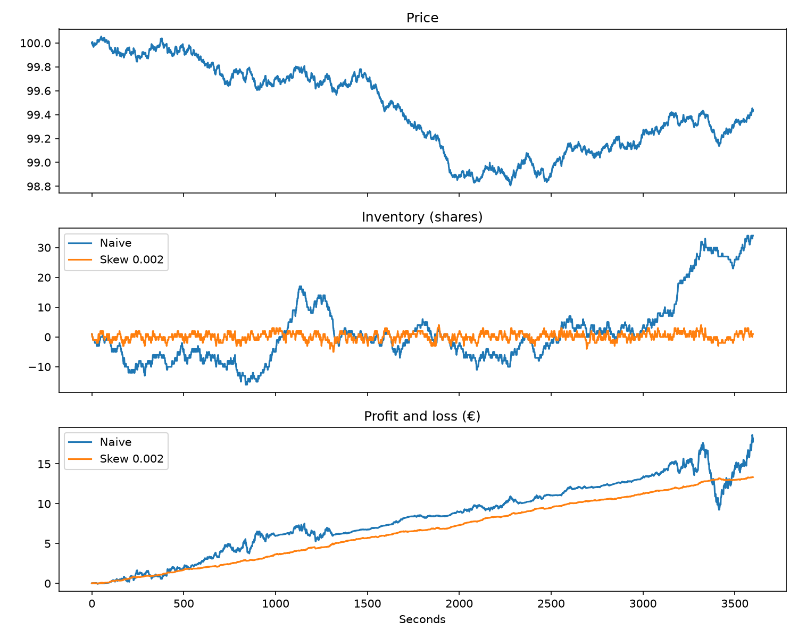
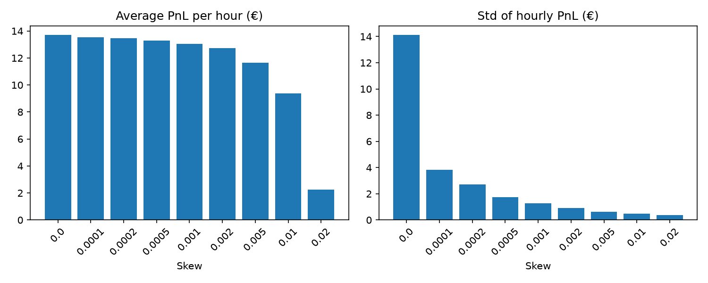

# Market-Making Simulator

A Python simulation of a market maker: a trader who continuously quotes a price to buy (bid) and a price to sell (ask), earns the spread between them, and has to manage the risk of the shares it accumulates.

The project asks three questions:

1. **How wide should a market maker quote?** Tighter quotes trade more often but earn less per trade.
2. **How should it control inventory risk?** Shares held while the price moves can wipe out many trades' worth of spread.
3. **What happens when some traders know where the price is going?** (adverse selection)

Everything is simulated from scratch with NumPy, so every result is reproducible from a seed.

---

## The model

**Price.** The fair (mid) price follows a random walk, one step per second over one hour:

```
price[t+1] = price[t] + shock,   shock ~ Normal(0, 0.01)
```

**Random traders.** Each second, a trader may sell to our bid and another may buy from our ask. The further a quote is from the mid, the less likely it is to be filled:

```
P(fill per second) = A * exp(-k * distance),   A = 0.5, k = 100
```

**Market maker.** Quotes `bid = r - d` and `ask = r + d` around a *reservation price*

```
r = mid - skew * inventory
```

With `skew = 0` it always quotes symmetrically around the mid (the naive market maker). With `skew > 0` it lowers both quotes when it holds shares and raises them when it is short, pushing inventory back towards zero. This is the core idea of the Avellaneda–Stoikov (2008) model.

**Informed traders.** With probability `informed_rate` per second, a trader who can see the price `horizon` seconds ahead buys from us if that future price is above our ask, or sells to us if it is below our bid.

**PnL** is marked to market every second: `cash + inventory * mid`.

---

## Results

### 1. The optimal quote distance

Expected spread income per second on one side is `distance * P(fill)`. It peaks at `distance = 1/k = 0.01`: quoting tighter earns too little per trade, quoting wider loses too many trades. At the optimum, expected income is about **13 € per hour** (both sides).



### 2. The naive market maker: profitable on average, but risky

1,000 simulated hours, fixed quotes at mid ± 0.01:

| Metric | Value |
|---|---|
| Average PnL per hour | 14.41 € |
| Std of hourly PnL | 14.54 € |
| Losing hours | 12% |
| Worst hour | −59.27 € |
| Average max inventory | 42 shares |

The average is close to the theoretical spread income of about 13 € (with a std of 14.5 €, the average itself is only known to within about ±1 €): with random traders, inventory gains and losses cancel out on average. But inventory drifts freely, and holding 40+ shares while the price moves makes the result swing as much as it earns.

The same simulated hour, with the same traders, for the naive market maker and one with an inventory skew of 0.002:



### 3. Inventory skew: much less risk for a little less profit

300 hours per row, same random paths for every row:

| Skew | Avg PnL | Std | Avg PnL / Std | Losing hours | Worst hour | Avg max inventory |
|---|---|---|---|---|---|---|
| 0 | 13.71 | 14.12 | 0.97 | 13% | −26.42 | 41.3 |
| 0.0001 | 13.54 | 3.82 | 3.54 | 0% | 2.76 | 16.8 |
| 0.0002 | 13.48 | 2.70 | 5.00 | 0% | 5.95 | 13.0 |
| 0.0005 | 13.28 | 1.74 | 7.65 | 0% | 8.60 | 9.0 |
| 0.001 | 13.04 | 1.26 | 10.32 | 0% | 9.54 | 6.7 |
| 0.002 | 12.72 | 0.92 | 13.85 | 0% | 10.56 | 5.0 |
| 0.005 | 11.66 | 0.61 | 19.10 | 0% | 9.62 | 3.1 |
| 0.01 | 9.37 | 0.48 | 19.51 | 0% | 8.10 | 2.0 |
| 0.02 | 2.23 | 0.36 | 6.19 | 0% | 1.19 | 1.0 |



- A small skew (0.001–0.002) cuts risk by over 90% while keeping 93–95% of the profit.
- Too much skew destroys profit: at 0.02, holding a single share already pushes the ask below the mid, so the market maker sells below fair value just to stay flat.

### 4. Adverse selection: tight quotes and fast inventory turnover

With skew 0.002, informed traders who see 60 seconds ahead (100 hours per row):

| Informed rate | d = 0.01 | d = 0.02 | d = 0.03 | d = 0.05 |
|---|---|---|---|---|
| 0 | 12.71 | 9.67 | 5.31 | 1.25 |
| 0.02 | 12.40 | 8.79 | 3.83 | −0.31 |
| 0.05 | 11.96 | 7.55 | 1.98 | −2.43 |
| 0.10 | 11.30 | 6.10 | −0.52 | −5.39 |

*(average PnL per hour, €)*

**Wide quotes are hurt the most.** Random traders are price-sensitive and stop trading at wide quotes; informed traders don't. Quoting wide changes the *mix* of counterparties towards informed traders, so most remaining trades lose money.

**Why the skew protects the market maker.** Distance 0.01, informed rate 0.1, loss compared with no informed traders:

| | Information 5 s ahead | Information 60 s ahead |
|---|---|---|
| No skew | −4.9 € | **−19.0 €** (average PnL turns negative, 51% losing hours) |
| Skew 0.002 | −2.8 € | −1.4 € |

With skew, the market maker passes an unwanted share on to random traders within seconds, before a slow informed move fully happens. Against fast information it can't unload in time, so the protection weakens. This is a simple version of why real market makers compete so hard on speed.

---

## Limitations

- **Random-walk price** with constant volatility: no trends, jumps or volatility clustering.
- **One market maker, one share per trade.** Real markets have competing market makers and order sizes; competition is only captured implicitly through `k`.
- **Stylised informed traders** who see the future price exactly.
- **No fees, latency or queue position.**
- **Parameters are illustrative**, not calibrated to a real asset.

## Possible extensions

- Avellaneda–Stoikov skew that depends on volatility and time left (`skew = γ σ² (T − t)`)
- Inventory limits and end-of-hour liquidation
- Several competing market makers, or a full limit order book
- Calibrating `A`, `k` and volatility to real data

---

## Project structure

```
market-making-sim/
├── src/
│   └── simulation.py      # price simulator, fill model, market maker
├── notebooks/
│   ├── 01_simulation.ipynb    # step-by-step exploration
│   └── 02_results.ipynb       # reproduces every table in this README
├── tests/
│   └── test_simulation.py
└── requirements.txt
```

## How to run

```bash
python -m venv .venv
.venv\Scripts\activate          # Windows  (Mac/Linux: source .venv/bin/activate)
pip install -r requirements.txt
python -m pytest                # run the tests
```

Then run `notebooks/02_results.ipynb` to reproduce every table in this README (about 3 minutes; all experiments use fixed seeds).

## References

- Avellaneda, M. and Stoikov, S. (2008). *High-frequency trading in a limit order book.* Quantitative Finance, 8(3).
- Glosten, L. and Milgrom, P. (1985). *Bid, ask and transaction prices in a specialist market with heterogeneously informed traders.* Journal of Financial Economics, 14(1).

---

*Author: Haoran ([@haoranyu27](https://github.com/haoranyu27))*
